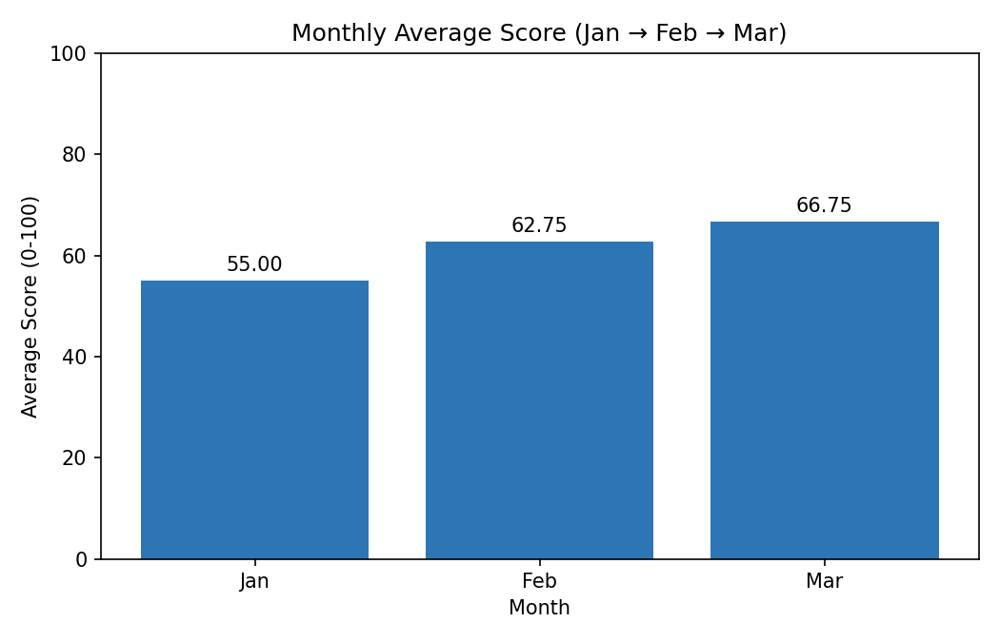

# 📊 Training Performance Analysis — Set C

> **Red & White Skill Education · Data Analysis Practical Exam**
> 🎓 **Student ID:** 11276

An end-to-end analysis of training assessments across **4 courses**, **2 departments** and **3 batches** over **Jan → Mar**, done with **Excel, SQL, Python and Power BI**. All four tools are reconciled to the same numbers. ✅

---

## 🎯 Project Goal

Find out **which courses and departments are underperforming**, how scores **trend month by month**, and which **batches** perform best, using one cleaned dataset shared by every tool.

---

## 🗂️ Repository Structure

```
📦 project-root
├── 📁 data/raw/
│   ├── assessments.csv          # Fact table (13 rows, 1 exact duplicate)
│   └── courses.csv              # Lookup table (4 courses)
├── 📁 excel/
│   └── analysis.xlsx            # Raw → Lookup → Clean → Summary (+ PivotTable)
├── 📁 sql/
│   ├── setup.sql                # Schema + data load (SQLite)
│   └── queries.sql              # S2a, S2b, S2c + integrity checks
├── 📁 python/
│   └── analysis.py              # Clean, merge, summarise, chart
├── 📁 power bi/
│   └── powerbi_dashboard.pbix.zip   # Dashboard (zipped)
├── 📁 outputs/
│   ├── clean_data.csv           # Cleaned & merged dataset (12 rows)
│   ├── python_summary.csv       # Department summary
│   ├── python_chart.png         # Monthly average score chart
│   └── sql/                     # Exported SQL query results (CSV)
├── 📄 requirements.txt
├── 📄 .gitignore
└── 📄 README.md
```

---

## 🧾 Dataset

| 📄 File | 📏 Rows | 🧩 Columns |
|---|---|---|
| `assessments.csv` | 13 → **12** after cleaning | `assessment_id`, `month`, `course_id`, `batch`, `score`, `attendance_pct` |
| `courses.csv` | 4 | `course_id`, `course`, `department` |

| 🏷️ Course ID | 📚 Course | 🏢 Department |
|---|---|---|
| C1 | Excel | Business |
| C2 | PowerBI | Business |
| C3 | SQL | Technology |
| C4 | Python | Technology |

---

## 🧹 Data Cleaning & Rules

- 🗑️ Removed **1 exact duplicate** row (`12, Mar, C4, Weekend, 42, 65`) → **13 → 12 rows**
- 🔗 Joined assessments with courses on `course_id` → **0 unmatched keys**
- ✔️ **Pass rule:** `pass_flag = 1` when `score >= 50`, otherwise `0`
- 📅 `month` treated as an ordered category: **Jan → Feb → Mar**
- 📐 All rates are computed from underlying counts (passing ÷ total), never by averaging percentages

---

## 🏆 Key Results

| 📌 Metric | 🔢 Value |
|---|---|
| Total assessments | **12** |
| Average score | **61.50** |
| Overall pass rate | **66.67%** (8 / 12) |
| 🔴 Lowest pass rate course | **Python (C4) — 33.33%** (1 / 3) |

### 🏢 By Department

| Department | Avg Score | Pass Rate |
|---|---|---|
| Business | 67.00 | 83.33% |
| Technology | 56.00 | 50.00% |

### 👥 By Batch

| Batch | Avg Score | Pass Rate |
|---|---|---|
| Evening | 67.00 | 75.00% |
| Morning | 61.25 | 75.00% |
| Weekend | 56.25 | 50.00% |

### 📈 Monthly Trend

| Month | Avg Score |
|---|---|
| Jan | 55.00 |
| Feb | 62.75 |
| Mar | 66.75 |

📌 **Insight:** Scores improve every month, but the **Technology** department and the **Weekend** batch stay behind. **Python** is the weakest course.



---

## 🛠️ How to Run Each Part

### 📗 1. Excel
Open `excel/analysis.xlsx`. Sheets: **Raw** (unchanged data) → **Lookup** → **Clean** (duplicate removed, department + pass flag added) → **Summary** (COUNTIFS table, AVERAGEIFS layout and a native PivotTable).

### 🗄️ 2. SQL (SQLite)
```bash
sqlite3 project.db < sql/setup.sql
sqlite3 project.db < sql/queries.sql
```
Run order: `setup.sql` first, then `queries.sql`.

| 🔖 Query | 📝 Purpose |
|---|---|
| S2a | Average score by department |
| S2b | Underperforming courses (avg score < 60) |
| S2c | Top two batches by average score |
| S3 (D1, D2) | Integrity checks: LEFT JOIN row counts and unmatched keys |

SQL results are exported to `outputs/sql/`.

### 🐍 3. Python
```bash
pip install -r requirements.txt
python python/analysis.py
```
⚠️ Run from the **repository root** so relative paths work. Generates `clean_data.csv`, `python_summary.csv` and `python_chart.png` in `outputs/`.

### 📊 4. Power BI
1. Unzip `power bi/powerbi_dashboard.pbix.zip` to get the `.pbix` file and open it in **Power BI Desktop**.
2. **Model:** `courses[course_id]` → `assessments[course_id]` (one-to-many, single direction)
3. **DAX measures:** `Assessment Count`, `Avg Score`, `Pass Rate`
4. **Report page:** 3 KPI cards, department bar chart, monthly trend (Jan → Feb → Mar) and a batch slicer

---

## 🔄 Refreshing the Power BI Data Source

After cloning the repo, point Power BI to your local copy of the data:

1. Home → **Transform data** → **Data source settings**
2. Select the two CSV sources → **Change Source…**
3. Browse to the cloned `data/raw/` files → **OK**
4. **Close & Apply** → **Refresh**

*(Alternative: Transform data → `assessments` → Advanced Editor → edit the `File.Contents("...")` path.)*

---

## ✅ Cross-Tool Reconciliation

All four tools produce the same numbers:

| 🔎 Check | Excel | SQL | Python | Power BI |
|---|:---:|:---:|:---:|:---:|
| Rows after cleaning = 12 | ✅ | ✅ | ✅ | ✅ |
| Technology avg score = 56.00 | ✅ | ✅ | ✅ | ✅ |
| Business avg score = 67.00 | ✅ | ✅ | ✅ | ✅ |
| Overall pass rate = 66.67% | ✅ | ✅ | ✅ | ✅ |

---

## 🧰 Tools & Versions

| 🔧 Tool | 📌 Version |
|---|---|
| Excel | _add version_ |
| SQLite | 3.x |
| Python | 3.x · `pandas>=2.0` · `matplotlib>=3.7` |
| Power BI Desktop | _add version_ |

---

## 🎥 Demo Video

▶️ _add video link here_

---

## 👤 Author

**Student ID:** 11277
**Exam:** Data Analysis Practical — Set C (Training Performance)


## Video Link

https://drive.google.com/file/d/1oHDCIaH9F27amgPJazOZ7pn077rTWs4G/view?usp=sharing